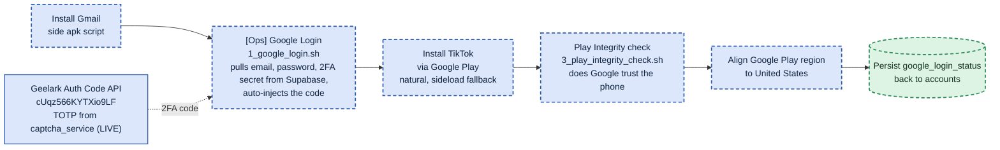

# Account Lifecycle — New Profile to Retirement

*Hand-authored journey of a single account. The spine is the setup SOP "Steps for Setting up and Warming an Account", reconciled against the live n8n estate and the account-ops Supabase project (`qlcmgxgwpzmiebzxflai`) as of 2026-07-24. This is a lifecycle view, not a runtime view. For the runtime posting and health path see [[Account Ops & Geelark Flow]]. For the tables see [[Account Ops Data Model]]. Source SOP saved at `~/Claude/arch-diagrams/SETUP_SOP_source.txt`.*

Read it top to bottom as a life story. Stage 0 is the decision to add a profile. Stage 7 is retirement, which loops back to Stage 0 when a phone is recycled. Color here means WHO does the step, not what kind of step it is. Orange is a manual operator step, blue is an n8n workflow, purple is the Geelark cloud phone or dashboard, green is Supabase state, grey is an outside vendor or platform. A dashed border means the workflow is built but switched off today.

The honest headline: the fresh-account path is mostly manual buying plus Geelark dashboard work, and the on-phone setup automation was built today but is still off. The live automated spine is intake, factory reset, the GPS device warmup, scheduling, posting, the health checks, and the auth-code helper. The behavioral warmup and the whole account-setup script chain are built but inactive.

```mermaid
flowchart TB
    classDef manual   fill:#FBE3D0,stroke:#C2601E,color:#3A1E08,stroke-width:1.5px;
    classDef n8n      fill:#DCE7FB,stroke:#2E5AAC,color:#10233F,stroke-width:1.5px;
    classDef geelark  fill:#F3E1F7,stroke:#8A3FA0,color:#331338,stroke-width:1.5px;
    classDef supa     fill:#DDF3E4,stroke:#2E8B57,color:#14331F,stroke-width:1.5px;
    classDef ext      fill:#E9ECEF,stroke:#6C757D,color:#212529,stroke-width:1.5px;
    classDef inactive stroke-dasharray:6 4,stroke-width:2px;

    subgraph sg0["Stage 0 - Decide and source (manual)"]
    direction TB
    s0_decide["Operator decides to add a profile"]
    s0_vendor["VENDOR PATH: buy a pre-warmed account plus proxy<br/>from Superwarm or Tokportal<br/>(dominant today, 20 of 32)"]
    s0_email["FRESH PATH: buy email accounts<br/>from accsmarket or the whatsapp seller<br/>then add the codes to the captcha service"]
    s0_proxy["Buy a proxy from proxy-cheap<br/>dedicated US IP, premium, change http to socks5"]
    s0_num["Buy an SMS number from TextVerified<br/>platform set to All"]
    s0_ipqs{"IPQS gate on proxy and email<br/>keep only residential or mobile,<br/>fraud under 50, no recent abuse,<br/>geo matches the metro"}
    s0_rule["Coherence rule: proxy city = GPS = timezone = language,<br/>one US metro. Device model varied. Spread across subnets."]
    end

    subgraph sg1["Stage 1 - Build the phone in Geelark (manual dashboard)"]
    direction TB
    s1_addproxy["Add the proxy in the Geelark Proxy Tab<br/>IP2LOCATION, type SOCKS5, then Check Proxy"]
    s1_profile["New Profile 'Profile #', group US accounts,<br/>attach the proxy, Wifi, TextVerified number,<br/>Samsung Galaxy varied across android versions"]
    s1_reset["Run [Ops] Factory Reset - On Demand<br/>id aB24JEEA8COgeoeA<br/>wipe and set language and region to the proxy metro<br/>(LIVE workflow, manual trigger)"]
    end

    subgraph sg2["Stage 2 - Intake and on-phone setup scripts"]
    direction TB
    s2_intake["[Ops] New Account Intake<br/>id lpGjVbN5e7xLvBkX<br/>operator form, writes the sheet and the accounts row (LIVE)"]
    s2_scripts["On-phone Geelark scripts (BUILT TODAY, INACTIVE):<br/>Gmail sideload, [Ops] Google Login (1_google_login.sh),<br/>TikTok install, Play Integrity (3_play_integrity_check.sh),<br/>align Play Store region to US. See the zoom below."]
    s2_auth["Geelark Auth Code API<br/>id cUqz566KYTXio9LF<br/>serves the Google 2FA code (LIVE helper)"]
    end

    subgraph sg3["Stage 3 - Create the social account"]
    direction TB
    s3_tt["Create TikTok: Continue with Google using the Gmail,<br/>TextVerified number for the signup SMS (manual)"]
    s3_ig["Instagram path: IG OAuth Handler<br/>id 0tyDiFhi89G3sHCC creates the IG row and token (LIVE)"]
    s3_save[("Save to Supabase accounts: username, platform,<br/>profile, character, proxy, google email<br/>(API exists, save step still manual)")]
    s3_profile["Set profile picture, bio, highlights by hand (manual)"]
    end

    subgraph sg4["Stage 4 - Warmup"]
    direction TB
    s4_unified["[Warmup] Unified Scheduler<br/>id QDUtABHSG4FMTrQX<br/>age tier, two sessions a day: morning Watching,<br/>evening Interaction, skips accounts under 2 days<br/>(intended primary, INACTIVE)"]
    s4_device["Device Warmup - Auto<br/>id 3AsUAUOwUgXa60cy<br/>GPS drift near home metro plus power cycle, 2x/day (LIVE)"]
    s4_more["TikTok Ramp plus Maintenance and viral-repost seeding<br/>ids Wv6J5DHLNGP4WYpy, k3EwfcKFW5TwHlRl (INACTIVE)"]
    end

    subgraph sg5["Stage 5 - Post"]
    direction TB
    s5_gate["[Unified] Scheduling Agent plus Inventory Monitor<br/>pick eligible accounts by age and content type (LIVE)"]
    s5_post["unified-posting-agent<br/>id lioNzkWRocyDvZS5<br/>runs each post as a Geelark task, 1 to 3 a day (LIVE)"]
    s5_publish["Physical publish on the phone and how the<br/>media and caption reach it<br/>(ASSUMED, the SOP lists this as still open)"]
    s5_platform["Post goes live on Instagram or TikTok"]
    end

    subgraph sg6["Stage 6 - Monitor"]
    direction TB
    s6_collapse["[Health] View-Collapse Detector<br/>id 2Goujvw8qSvVzIfo<br/>infers bans from view collapse (LIVE)"]
    s6_login["Account Health Checks, Geelark login probes<br/>ids CXVxRMOUkLluRdBc, CJQKNXIBPB0B8LF5 (LIVE)"]
    s6_audit["[Audit] Proxy and Account Health - Biweekly<br/>id FknqQM7GNJJmViRP (INACTIVE)"]
    s6_state[("accounts.health_status, account_events,<br/>geelark_health_log")]
    end

    subgraph sg7["Stage 7 - Retire and replace"]
    direction TB
    s7_ban[("Ban inferred: health_status='banned'<br/>plus account_events row (auto, by detector)")]
    s7_deact["Set is_active=false to pull from rotation<br/>(manual, no automation logs the actor)"]
    s7_replace["Operator decides on a replacement,<br/>factory reset recycles the phone (manual)"]
    end

    subgraph sgL["Legend"]
    direction TB
    leg_op["Operator or manual step"]
    leg_n8n["n8n automation (workflow named)"]
    leg_gee["Geelark phone or dashboard"]
    leg_sup["Supabase state"]
    leg_ext["Outside vendor or platform"]
    leg_off["Dashed border = built but inactive"]
    end

    s0_decide --> s0_vendor
    s0_decide --> s0_email
    s0_email --> s0_proxy --> s0_num --> s0_ipqs --> s0_rule
    s0_rule --> s1_addproxy
    s0_vendor -.->|"arrives pre-warmed, skip most setup"| s2_intake

    s1_addproxy --> s1_profile --> s1_reset --> s2_intake
    s2_intake --> s2_scripts
    s2_auth -.->|"supplies the 2FA code"| s2_scripts
    s2_scripts --> s3_tt
    s3_tt --> s3_save
    s3_ig -.->|"IG identity"| s3_save
    s3_save --> s3_profile

    s3_profile --> s4_device
    s4_device -.->|"behavioral rungs would run here, all off"| s4_unified
    s4_unified -.-> s4_more

    s4_device --> s5_gate --> s5_post --> s5_publish --> s5_platform

    s5_platform -.->|"views"| s6_collapse
    s5_platform -.->|"login probe"| s6_login
    s6_collapse --> s6_state
    s6_login --> s6_state
    s6_audit -.-> s6_state

    s6_state --> s7_ban --> s7_deact --> s7_replace
    s7_replace -->|"recycle the phone, loop back"| s0_decide

    class s0_decide,s0_email,s0_ipqs,s0_rule,s3_tt,s3_profile,s5_publish,s7_deact,s7_replace,leg_op manual;
    class s1_reset,s2_intake,s2_scripts,s2_auth,s3_ig,s4_unified,s4_device,s4_more,s5_gate,s5_post,s6_collapse,s6_login,s6_audit,leg_n8n n8n;
    class s1_addproxy,s1_profile,leg_gee geelark;
    class s3_save,s6_state,s7_ban,leg_sup supa;
    class s0_vendor,s0_proxy,s0_num,s5_platform,leg_ext ext;
    class s2_scripts,s4_unified,s4_more,s6_audit,leg_off inactive;
```

## Stage 2 zoom: the on-phone Geelark scripts

This is the piece you asked about, the Geelark scripts that run on the phone. It is built but switched off, and lives in the [Ops] account-setup chain (the SOP names the shell scripts `1_google_login.sh` and `3_play_integrity_check.sh`). Everything dashed here is inactive today. The two solid nodes are the live helpers.

## What is live today versus built but off

Live today:

- **Factory reset.** [Ops] Factory Reset - On Demand wipes a phone and sets its language and region. A human triggers it.
- **Intake.** [Ops] New Account Intake writes the sheet and the `accounts` row. The real entry point.
- **Auth code helper.** Geelark Auth Code API serves the Google 2FA code. IG OAuth Handler creates the Instagram row.
- **Warmup, device level only.** Device Warmup - Auto does GPS drift plus a power cycle about twice a day. The behavioral app-usage warmup is parked, so no app-level warmup runs.
- **Scheduling and posting.** Inventory Monitor plus Scheduling Agent pick eligible accounts, and the unified-posting-agent posts 1 to 3 a day.
- **Monitoring.** View-Collapse Detector infers bans from views. Two Account Health Check jobs run Geelark login probes.

Built but off:

- **The on-phone setup scripts**, the whole Gmail, Google login, TikTok install, Play Integrity chain. Built 2026-07-24, being tuned.
- **The behavioral warmup**: [Warmup] Unified Scheduler (the SOP's intended primary warmup), TikTok Ramp plus Maintenance, and the viral-repost seeding job.
- **[Audit] Proxy and Account Health - Biweekly**, the proxy audit.

Manual today, by design:

- Buying accounts, proxies, and numbers, and the IPQS quality gate.
- Building the phone in the Geelark dashboard: adding the proxy, creating the profile, attaching the number.
- Creating the TikTok account, filling the sheet metadata, and setting the profile picture, bio, and highlights.

## Still open (from the SOP, not yet answered)

- The actual publish step on the phone, a Geelark post task, and how the media and caption get to the phone.
- For a fresh account, must it finish the full 14-day ramp before its first post, or can posting start earlier.
- How a piece of content is matched to a specific account and character.
- On Phone Number Expiry, whether you re-rent a TextVerified number and whether the account needs it again after signup.
- Whether the auth-code service and the TextVerified SMS service should be merged into one verification service.
- Where `captcha_service` rows get populated in the live flow. The SOP says the operator adds email codes to it during buying, and it is empty today because no fresh account has run the new path yet.

## Related

- [[Account Ops & Geelark Flow]]: the runtime posting and health close-up
- [[System Overview]]: the whole spine, one level up
- [[Account Ops Data Model]]: the tables and their string join keys
- [[Diagrams]]: index for this folder
- [[account-health-system]]: the AI-memory note on the health layer
