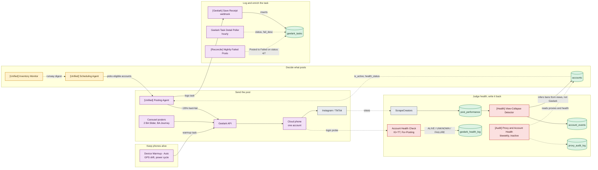

# Account Ops & Geelark Flow

*Hand-authored close-up of the account-ops layer, grounded in the live n8n estate and the Supabase project (`qlcmgxgwpzmiebzxflai`) as of 2026-07-23. This zooms into planes 4, 5, and 6 of the [[System Overview]]. For the tables behind it, see [[Account Ops Data Model]]. For a single workflow, open its graph under [[_Workflows — Index]].*

Follow one post from left to right. The Scheduling Agent picks an eligible account, the Posting Agent fires it at the Geelark API, the Geelark API drives the one cloud phone that runs that account, and the phone posts to Instagram or TikTok. On the way out, Save Receipt logs the task and the Poller enriches it. On the way back, two separate health checks judge the account and write the verdict onto `accounts`.

Two things this diagram is built to make obvious. First, posting is lossy: about one in five posts hard-fails at Geelark. Second, a ban is never confirmed at Geelark. It is inferred from views collapsing, by a different workflow than the one that checks whether the phone can still log in.

## The details that matter

- The join key is one string. Everything hangs off `accounts.geelark_profile` in the form `Profile N`. `geelark_tasks.serial_name` carries that same string. Do not join on `env_id`, which is Geelark's numeric device id and matches nothing in accounts.
- Receipts come in two writes. Save Receipt inserts the task row when the post is queued. The Poller updates that same row hourly with the real outcome, `fail_code`, and `fail_desc`. Prefer `fail_desc` for the human reason, since the fail-code lookup is incomplete.
- Warmup is one workflow, not a subsystem. Only Device Warmup - Auto runs live. Every other warmup-named workflow is switched off.
- The two health signals are independent. Login liveness lands in `geelark_health_log` and has never returned BANNED, because a login probe cannot see a ban. Ban inference lands in `account_events` and `accounts.health_status`, written by the View-Collapse Detector from view collapse. A phone can log in fine while its account is effectively dead.
- The proxy audit is built but parked. The biweekly audit that would snapshot proxies into `proxy_audit_log` exists but is inactive.

## Related

- [[System Overview]]: the whole spine, one level up
- [[Account Ops Data Model]]: tables, string join keys, writer provenance
- [[Unified Posting Agent]]: the live node graph of the posting workflow
- [[Health View-Collapse Detector]]: the live node graph of the ban recorder
- [[account-health-system]]: the AI-memory note on this layer
