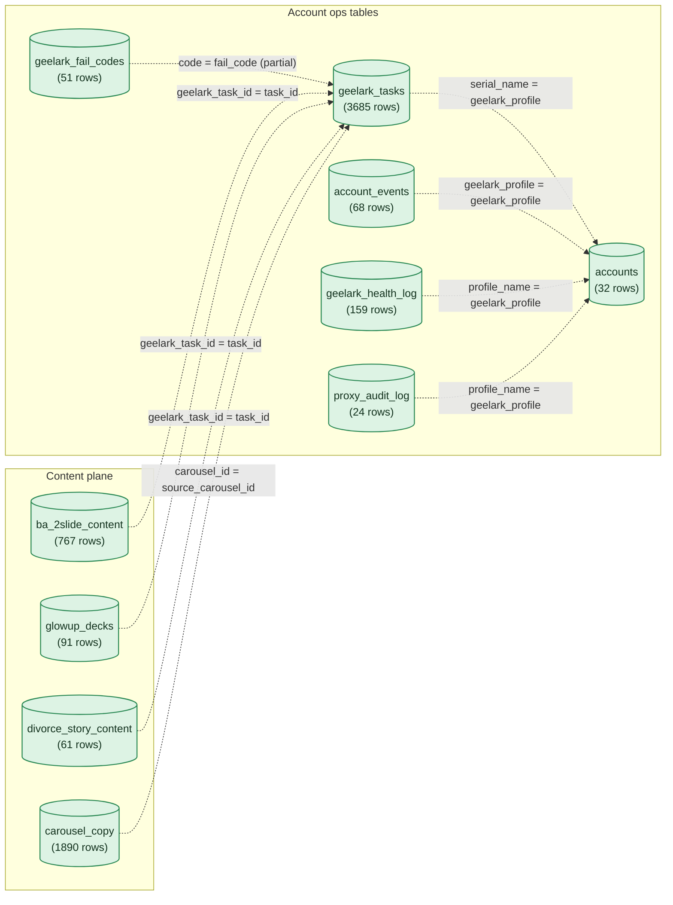
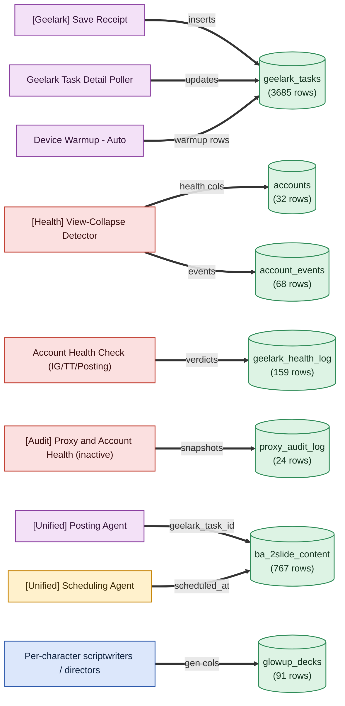

# Account Ops Data Model

*Auto-generated from the live account-ops Supabase project (`qlcmgxgwpzmiebzxflai`). Row counts and column checks are live as of 2026-07-24. The join-key semantics and writer provenance are verified architecture facts.*

<!-- AUTO-GENERATED by arch-diagrams/generate.py -- do not hand-edit. Re-run to refresh. -->

The whole account-ops model hangs off one human label string, `accounts.geelark_profile` in the form `Profile N`. Every satellite table carries that same string under a different column name. None of these links is a real database foreign key. Every join is a convention enforced by workflow code, so the diagram draws them as dashed edges labeled with the string key.

One trap to remember: `geelark_tasks.env_id` is Geelark's numeric device id and joins to nothing in accounts. Always join on `serial_name`, never `env_id`.

## The data model

Cylinders are Supabase tables. Dashed edges are the convention-only string joins. Row counts are live.

## Who writes what

Solid edges show which n8n workflow writes each table. Readers are listed in the table below.

## Table reference

| Table | Rows (live) | Join key to accounts | Writers | Readers |
| --- | --- | --- | --- | --- |
| `accounts` | 32 rows | the hub, keyed by geelark_profile | View-Collapse Detector, intake and warmup | Posting, Scheduling, Inventory, Health Checks, audit |
| `geelark_tasks` | 3685 rows | serial_name = geelark_profile | Save Receipt (insert), Task Detail Poller (update), Device Warmup | Reconcile Nightly Failed Posts, audit, content tables |
| `account_events` | 68 rows | geelark_profile | View-Collapse Detector | health reporting, audit |
| `geelark_health_log` | 159 rows | profile_name = geelark_profile | Account Health Check (IG/TT and For-Posting) | audit, dashboards |
| `geelark_fail_codes` | 51 rows | code = geelark_tasks.fail_code (partial) | maintained by hand | geelark_tasks and health log joins |
| `proxy_audit_log` | 24 rows | profile_name = geelark_profile | Biweekly Proxy Audit (inactive) | audit reporting |

## Two health signals, kept separate

There are two independent health signals and they do not agree by design. `geelark_health_log` records Geelark login liveness (ALIVE, UNKNOWN, or a failure), written by the Account Health Check workflows. `account_events` plus `accounts.health_status` record ban inference from view collapse, written by the View-Collapse Detector. Bans are never confirmed at Geelark, they are inferred from views, so the login probe can say ALIVE while the detector has already marked the account banned.

## Content plane bridge

Generated content rows carry the posting linkage. A content row gets a `geelark_profile` (which phone posts it) and, once the Posting Agent fires, a `geelark_task_id` that points back to `geelark_tasks.task_id`. Carousels are the exception: `carousel_copy` has no `geelark_task_id`, so its posting linkage rides on `geelark_tasks.source_carousel_id` instead.

Back to [[_Workflows — Index]].
