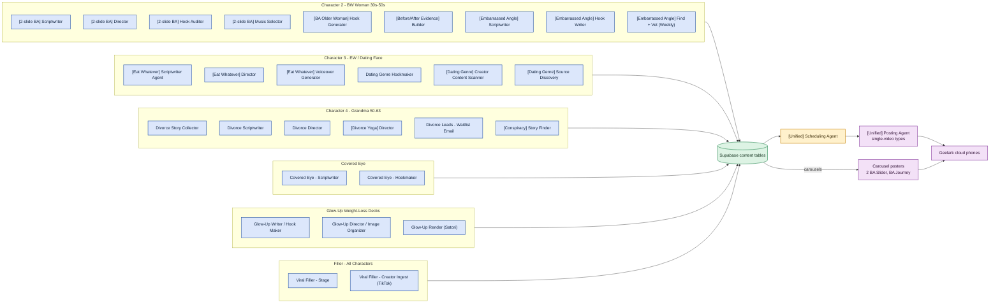

# Content Pipelines by Character

*Hand-authored map of the content-generation lanes, grouped by character, grounded in the live n8n estate as of 2026-07-23. Every workflow shown was confirmed ACTIVE. Dark lanes are left out on purpose, so the diagram does not imply work that is not running. For the shared posting and health path these lanes feed, see [[System Overview]] and [[Account Ops & Geelark Flow]].*

Each character is its own writer lane. The workflows inside a lane do not call each other directly. They hand off through Supabase row status, so a Hookmaker writes a row, a Scriptwriter picks it up, a Director picks that up, and so on. That is why the lanes are drawn as groups feeding one shared content store, rather than as one long chain.

All lanes end the same way. Finished content lands in a Supabase content table, the Scheduling Agent times it, and the Unified Posting Agent posts single-video types while separate carousel posters handle the slider formats.

## What is deliberately not here

These lanes look like they should exist but are dark as of 2026-07-23, so drawing them would be a lie.

- Grandma BA (GBA). The whole GBA content-generation lane is off. No active writer, director, music, or poster.
- Cooking Conspiracy writers. Only `[Conspiracy] Story Finder` runs. The Conspiracy Hook Writer and Scriptwriter are off, so the lane finds stories but does not currently write them.
- Per-character posters. Every single-video per-character poster is off. Their posting was folded into the Unified Posting Agent. Carousels are the exception and keep their own posters.

## Notes on a few nodes

- Filler is staging, not scripting. `Viral Filler - Stage` matches clips and writes hooks into the render queue. `Creator Ingest` pulls new source clips. The local worker renders them.
- Glow-Up Render (Satori) is a render step, kept in the lane because it is the Glow-Up lane's own active workflow rather than a shared renderer.
- Filler posts through the Unified Posting Agent as the FIL type, so it shares the same posting box as the other single-video lanes.

## Related

- [[System Overview]]: where these lanes sit in the whole loop
- [[Account Ops & Geelark Flow]]: what happens after the post is fired
- [[Diagrams]]: index for this folder
- [[content-system-map]]: the AI-memory note on the content type registry
