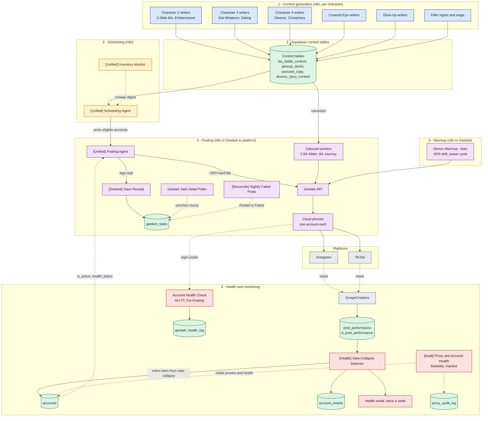

# System Overview

*Hand-authored overview of the Peptide Miracles pipeline, grounded in the live n8n estate and the account-ops Supabase project (`qlcmgxgwpzmiebzxflai`) as of 2026-07-23. This is the money diagram. It shows the planes and the main arrows, not every workflow. For a single workflow, open its graph under [[_Workflows — Index]]. For the tables, see [[Account Ops Data Model]].*

The loop in one sentence: n8n writers generate content into Supabase, a scheduling agent decides what posts when, a posting agent drives Geelark cloud phones to post to Instagram and TikTok, a warmup job keeps the phones alive, and two health signals watch what happens and write the verdict back onto the accounts.

Read it top to bottom. Each box is a plane, not a single script. Colors follow the house palette: blue is content generation, green is a Supabase table, yellow is scheduling, purple is posting and the Geelark device layer, red is health and monitoring, grey is an outside service.

## How to read the breaks

Three places this loop is known to break, all visible above.

- Posting is not clean. Roughly one in five posts through the Posting Agent hard-fails at the Geelark step. That is the `~20% hard-fail` edge.
- Bans are guessed, not confirmed. The `infers bans from view collapse` edge is the only ban signal. Geelark never tells us an account is banned, so the detector infers it from views dropping.
- Two health signals disagree by design. The login probe writes `geelark_health_log` and can say ALIVE while the detector has already marked the same account banned in `accounts`. They measure different things.

## Related

- [[Account Ops & Geelark Flow]]: the same posting and health path, zoomed in
- [[Content Pipelines by Character]]: what feeds plane 1
- [[Account Ops Data Model]]: the tables and their string join keys
- [[Diagrams]]: index for this folder
- [[Architecture — How The System Fits Together]]: the prose version of this loop
