# Account Health Check For Posting

*Auto-generated node graph of the live n8n workflow `Account Health Check (For Posting)` (id `CJQKNXIBPB0B8LF5`). State: active. Node count: 28. Pulled 2026-07-24.*

<!-- AUTO-GENERATED by arch-diagrams/generate.py -- do not hand-edit. Re-run to refresh. -->

> [!note] Live n8n name is `Account Health Check (For Posting)`. This note is filed under a stable name so re-runs do not orphan the file.

Login probe aimed at the posting fleet. Writes health verdicts and a Google Sheet.

Shapes: stadium is a trigger, rhombus is an if branch, hexagon is a switch or merge, parallelogram is a code node, cylinder is a datastore, double-box is a loop. Colors group nodes by role.

```mermaid
flowchart LR
    classDef trigger fill:#FFF1CC,stroke:#C8860A,color:#3A2A05,stroke-width:1.5px;
    classDef store   fill:#DDF3E4,stroke:#2E8B57,color:#14331F,stroke-width:1.5px;
    classDef branch  fill:#F3E1F7,stroke:#8A3FA0,color:#331338,stroke-width:1.5px;
    classDef loop    fill:#DCE7FB,stroke:#2E5AAC,color:#10233F,stroke-width:1.5px;
    classDef ext     fill:#FBE0E0,stroke:#C0392B,color:#3A1010,stroke-width:1.5px;
    classDef proc    fill:#E9ECEF,stroke:#6C757D,color:#212529,stroke-width:1.5px;

    n0(["Manual Trigger<br/>(manual)"])
    n1(["Daily 03:00 UTC (11:00 PHT)<br/>(schedule)"])
    n2["Init Run Context<br/>(set)"]
    n3[("Read FB and IG Accounts Sheet<br/>(sheets)")]
    n4[/"Filter Eligible Rows<br/>(code)"/]
    n5["List Geelark Phones<br/>(http)"]
    n6[/"Map Profile to envId<br/>(code)"/]
    n7{"Has envId?<br/>(if)"}
    n8{{"Switch by Platform<br/>(switch)"}}
    n9["Start IG Warmup<br/>(http)"]
    n10["Start TT Warmup<br/>(http)"]
    n11["Capture IG Task ID<br/>(set)"]
    n12["Capture TT Task ID<br/>(set)"]
    n13{{"Merge IG + TT<br/>(merge)"}}
    n14{{"Merge Warmed + Skipped<br/>(merge)"}}
    n15[/"Aggregate Task IDs<br/>(code)"/]
    n16["Wait 3 Minutes<br/>(wait)"]
    n17["Query Task Results<br/>(http)"]
    n18[/"Check All Done<br/>(code)"/]
    n19{"Continue Polling?<br/>(if)"}
    n20[/"Prepare Task List for Detail Fetch<br/>(code)"/]
    n21["Wait 2 Minutes<br/>(wait)"]
    n22[["Fetch Task Details (loop)<br/>(loop)"]]
    n23[/"Classify Results<br/>(code)"/]
    n24["Fetch Task Detail<br/>(http)"]
    n25["Write to Account Health Sheet<br/>(http)"]
    n26["Carry Task Detail<br/>(set)"]
    n27[/"Accumulate Task Detail<br/>(code)"/]

    n0 --> n2
    n2 --> n3
    n3 --> n4
    n4 --> n5
    n5 --> n6
    n6 --> n7
    n7 -->|"true"| n14
    n7 -->|"false"| n8
    n14 --> n15
    n8 -->|"instagram"| n9
    n8 -->|"tiktok"| n10
    n9 --> n11
    n11 --> n13
    n13 --> n14
    n10 --> n12
    n12 --> n13
    n15 --> n16
    n16 --> n17
    n17 --> n18
    n18 --> n19
    n19 -->|"true"| n20
    n19 -->|"false"| n21
    n20 --> n22
    n23 --> n25
    n24 --> n26
    n26 --> n27
    n27 --> n22
    n22 -->|"done"| n23
    n22 -->|"loop"| n24
    n21 --> n17
    n1 --> n2

    class n0,n1 trigger;
    class n2,n4,n6,n11,n12,n13,n14,n15,n16,n18,n20,n21,n23,n26,n27 proc;
    class n3 store;
    class n5,n9,n10,n17,n24,n25 ext;
    class n7,n8,n19 branch;
    class n22 loop;
```

Back to [[_Workflows — Index]] and [[Account Ops Data Model]].
