# Account Health Check IG and TT

*Auto-generated node graph of the live n8n workflow `Account Health Check (IG and TT)` (id `CXVxRMOUkLluRdBc`). State: active. Node count: 29. Pulled 2026-07-24.*

<!-- AUTO-GENERATED by arch-diagrams/generate.py -- do not hand-edit. Re-run to refresh. -->

> [!note] Live n8n name is `Account Health Check (IG and TT)`. This note is filed under a stable name so re-runs do not orphan the file.

Geelark login probe for Instagram and TikTok. Writes an ALIVE, UNKNOWN, or failure verdict per profile.

Shapes: stadium is a trigger, rhombus is an if branch, hexagon is a switch or merge, parallelogram is a code node, cylinder is a datastore, double-box is a loop. Colors group nodes by role.

```mermaid
flowchart LR
    classDef trigger fill:#FFF1CC,stroke:#C8860A,color:#3A2A05,stroke-width:1.5px;
    classDef store   fill:#DDF3E4,stroke:#2E8B57,color:#14331F,stroke-width:1.5px;
    classDef branch  fill:#F3E1F7,stroke:#8A3FA0,color:#331338,stroke-width:1.5px;
    classDef loop    fill:#DCE7FB,stroke:#2E5AAC,color:#10233F,stroke-width:1.5px;
    classDef ext     fill:#FBE0E0,stroke:#C0392B,color:#3A1010,stroke-width:1.5px;
    classDef proc    fill:#E9ECEF,stroke:#6C757D,color:#212529,stroke-width:1.5px;

    n0(["Tue & Fri 7 AM EST<br/>(schedule)"])
    n1["Init Run Context<br/>(set)"]
    n2[("Read Accounts (Supabase)<br/>(http)")]
    n3[/"Filter Eligible Rows<br/>(code)"/]
    n4["List Geelark Phones<br/>(http)"]
    n5[/"Map Profile to envId<br/>(code)"/]
    n6{"Has envId?<br/>(if)"}
    n7{{"Switch by Platform<br/>(switch)"}}
    n8["Start IG Warmup<br/>(http)"]
    n9["Start TT Warmup<br/>(http)"]
    n10["Capture IG Task ID<br/>(set)"]
    n11["Capture TT Task ID<br/>(set)"]
    n12{{"Merge IG + TT<br/>(merge)"}}
    n13{{"Merge Warmed + Skipped<br/>(merge)"}}
    n14[/"Aggregate Task IDs<br/>(code)"/]
    n15["Wait 3 Minutes<br/>(wait)"]
    n16["Query Task Results<br/>(http)"]
    n17[/"Check All Done<br/>(code)"/]
    n18{"Continue Polling?<br/>(if)"}
    n19[/"Prepare Task List for Detail Fetch<br/>(code)"/]
    n20["Wait 2 Minutes<br/>(wait)"]
    n21[["Fetch Task Details (loop)<br/>(loop)"]]
    n22[/"Classify Results<br/>(code)"/]
    n23["Fetch Task Detail<br/>(http)"]
    n24["Carry Task Detail<br/>(set)"]
    n25[("Write to Account Supabase<br/>(http)")]
    n26[("Log Geelark Health to Supabase<br/>(http)")]
    n27[/"Prepare Email Report<br/>(code)"/]
    n28["Send Email Report<br/>(gmail)"]

    n1 --> n2
    n3 --> n4
    n4 --> n5
    n5 --> n6
    n6 -->|"true"| n13
    n6 -->|"false"| n7
    n13 --> n14
    n7 -->|"instagram"| n8
    n7 -->|"tiktok"| n9
    n8 --> n10
    n10 --> n12
    n12 --> n13
    n9 --> n11
    n11 --> n12
    n14 --> n15
    n15 --> n16
    n16 --> n17
    n17 --> n18
    n18 -->|"true"| n19
    n18 -->|"false"| n20
    n19 --> n21
    n22 --> n25
    n22 --> n26
    n23 --> n24
    n24 --> n21
    n21 -->|"done"| n22
    n21 -->|"loop"| n23
    n20 --> n16
    n27 --> n28
    n0 --> n1
    n25 --> n27
    n2 --> n3

    class n0 trigger;
    class n1,n3,n5,n10,n11,n12,n13,n14,n15,n17,n19,n20,n22,n24,n27 proc;
    class n2,n25,n26 store;
    class n4,n8,n9,n16,n23,n28 ext;
    class n6,n7,n18 branch;
    class n21 loop;
```

Back to [[_Workflows — Index]] and [[Account Ops Data Model]].
