# Audit Proxy and Account Health Biweekly

*Auto-generated node graph of the live n8n workflow `[Audit] Proxy & Account Health — Biweekly` (id `FknqQM7GNJJmViRP`). State: inactive. Node count: 23. Pulled 2026-07-24.*

<!-- AUTO-GENERATED by arch-diagrams/generate.py -- do not hand-edit. Re-run to refresh. -->

> [!note] Live n8n name is `[Audit] Proxy & Account Health — Biweekly`. This note is filed under a stable name so re-runs do not orphan the file.

Inactive as of build. Reads Geelark proxies and the health tables and snapshots them for a biweekly audit.

Shapes: stadium is a trigger, rhombus is an if branch, hexagon is a switch or merge, parallelogram is a code node, cylinder is a datastore, double-box is a loop. Colors group nodes by role.

```mermaid
flowchart LR
    classDef trigger fill:#FFF1CC,stroke:#C8860A,color:#3A2A05,stroke-width:1.5px;
    classDef store   fill:#DDF3E4,stroke:#2E8B57,color:#14331F,stroke-width:1.5px;
    classDef branch  fill:#F3E1F7,stroke:#8A3FA0,color:#331338,stroke-width:1.5px;
    classDef loop    fill:#DCE7FB,stroke:#2E5AAC,color:#10233F,stroke-width:1.5px;
    classDef ext     fill:#FBE0E0,stroke:#C0392B,color:#3A1010,stroke-width:1.5px;
    classDef proc    fill:#E9ECEF,stroke:#6C757D,color:#212529,stroke-width:1.5px;

    n0(["Every Monday 14:00 UTC<br/>(schedule)"])
    n1(["Webhook — proxy-account-audit<br/>(webhook)"])
    n2[/"Biweekly Parity Gate<br/>(code)"/]
    n3{"Is Audit Week?<br/>(if)"}
    n4[/"Init Run<br/>(code)"/]
    n5["Geelark — Phone List<br/>(http)"]
    n6[/"Assert Geelark OK & Flatten Phones<br/>(code)"/]
    n7["Geelark — Proxy List<br/>(http)"]
    n8[/"Build IP Lookup Batches<br/>(code)"/]
    n9["Enrich Proxy IPs (ipapi.is)<br/>(http)"]
    n10[/"Build Proxy Check List<br/>(code)"/]
    n11["Geelark — Proxy Check<br/>(http)"]
    n12[("Read Health Log<br/>(http)")]
    n13[("Read Accounts<br/>(http)")]
    n14[("Read Recent Geelark Tasks<br/>(http)")]
    n15[("Read Fail Code Map<br/>(http)")]
    n16[("Read Account Events<br/>(http)")]
    n17[("Read Unpolled Tasks<br/>(http)")]
    n18[("Read Previous Audit Runs<br/>(http)")]
    n19[/"Run Audit Checks<br/>(code)"/]
    n20[("Persist Snapshot to proxy_audit_log<br/>(http)")]
    n21[/"Build Report<br/>(code)"/]
    n22["Send Report<br/>(gmail)"]

    n0 --> n2
    n2 --> n3
    n3 -->|"true"| n4
    n4 --> n5
    n1 --> n4
    n5 --> n6
    n6 --> n7
    n7 --> n8
    n8 --> n9
    n9 --> n10
    n10 --> n11
    n11 --> n12
    n12 --> n13
    n13 --> n14
    n14 --> n15
    n18 --> n19
    n19 --> n20
    n20 --> n21
    n21 --> n22
    n15 --> n16
    n16 --> n17
    n17 --> n18

    class n0,n1 trigger;
    class n2,n4,n6,n8,n10,n19,n21 proc;
    class n3 branch;
    class n5,n7,n9,n11,n22 ext;
    class n12,n13,n14,n15,n16,n17,n18,n20 store;
```

Back to [[_Workflows — Index]] and [[Account Ops Data Model]].
