# Device Warmup Auto

*Auto-generated node graph of the live n8n workflow `Device Warmup - Auto GPS drift (ACTIVE)` (id `3AsUAUOwUgXa60cy`). State: active. Node count: 16. Pulled 2026-07-24.*

<!-- AUTO-GENERATED by arch-diagrams/generate.py -- do not hand-edit. Re-run to refresh. -->

> [!note] Live n8n name is `Device Warmup - Auto GPS drift (ACTIVE)`. This note is filed under a stable name so re-runs do not orphan the file.

The only live warmup workflow. Powers phones on, drifts GPS, warms the account, powers off.

Shapes: stadium is a trigger, rhombus is an if branch, hexagon is a switch or merge, parallelogram is a code node, cylinder is a datastore, double-box is a loop. Colors group nodes by role.

```mermaid
flowchart LR
    classDef trigger fill:#FFF1CC,stroke:#C8860A,color:#3A2A05,stroke-width:1.5px;
    classDef store   fill:#DDF3E4,stroke:#2E8B57,color:#14331F,stroke-width:1.5px;
    classDef branch  fill:#F3E1F7,stroke:#8A3FA0,color:#331338,stroke-width:1.5px;
    classDef loop    fill:#DCE7FB,stroke:#2E5AAC,color:#10233F,stroke-width:1.5px;
    classDef ext     fill:#FBE0E0,stroke:#C0392B,color:#3A1010,stroke-width:1.5px;
    classDef proc    fill:#E9ECEF,stroke:#6C757D,color:#212529,stroke-width:1.5px;

    n0(["Hourly Tick<br/>(schedule)"])
    n1[/"Interval Gate<br/>(code)"/]
    n2[("Get Active Accounts<br/>(supabase)")]
    n3["List Geelark Phones<br/>(http)"]
    n4[("Get Busy Phones<br/>(http)")]
    n5[/"Build Action Plan<br/>(code)"/]
    n6[["Loop Per Action<br/>(loop)"]]
    n7[/"Summary<br/>(code)"/]
    n8["Start Phone<br/>(http)"]
    n9["Wait Boot<br/>(wait)"]
    n10["Screenshot Check<br/>(http)"]
    n11{"Is Running<br/>(if)"}
    n12[/"Build Phone Actions<br/>(code)"/]
    n13["Call Geelark<br/>(http)"]
    n14[("Save Receipt<br/>(supabase)")]
    n15["Stop Phone<br/>(http)"]

    n2 --> n3
    n5 --> n6
    n13 --> n14
    n6 -->|"done"| n7
    n6 -->|"loop"| n8
    n12 --> n13
    n0 --> n1
    n1 --> n2
    n8 --> n9
    n9 --> n10
    n10 --> n11
    n11 -->|"true"| n12
    n11 -->|"false"| n15
    n15 --> n6
    n3 --> n4
    n4 --> n5
    n14 --> n15

    class n0 trigger;
    class n1,n5,n7,n9,n12 proc;
    class n2,n4,n14 store;
    class n3,n8,n10,n13,n15 ext;
    class n6 loop;
    class n11 branch;
```

Back to [[_Workflows — Index]] and [[Account Ops Data Model]].
