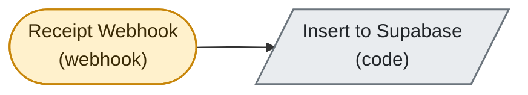

# Geelark Save Receipt

*Auto-generated node graph of the live n8n workflow `[Geelark] Save Receipt` (id `coizHIeUHRV5zOyd`). State: active. Node count: 2. Pulled 2026-07-24.*

<!-- AUTO-GENERATED by arch-diagrams/generate.py -- do not hand-edit. Re-run to refresh. -->

> [!note] Live n8n name is `[Geelark] Save Receipt`. This note is filed under a stable name so re-runs do not orphan the file.

Webhook. Inserts a geelark_tasks row the moment a posting or warmup task is handed to a phone.

Shapes: stadium is a trigger, rhombus is an if branch, hexagon is a switch or merge, parallelogram is a code node, cylinder is a datastore, double-box is a loop. Colors group nodes by role.

Back to [[_Workflows — Index]] and [[Account Ops Data Model]].
