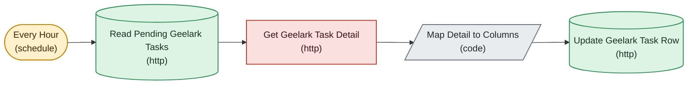

# Geelark Task Detail Poller

*Auto-generated node graph of the live n8n workflow `Geelark Task Detail Poller` (id `ARmIDPrV77c0k4zA`). State: active. Node count: 5. Pulled 2026-07-24.*

<!-- AUTO-GENERATED by arch-diagrams/generate.py -- do not hand-edit. Re-run to refresh. -->

Hourly. Enriches geelark_tasks rows with status, cost, and the plain-English fail reason pulled from Geelark.

Shapes: stadium is a trigger, rhombus is an if branch, hexagon is a switch or merge, parallelogram is a code node, cylinder is a datastore, double-box is a loop. Colors group nodes by role.

Back to [[_Workflows — Index]] and [[Account Ops Data Model]].
