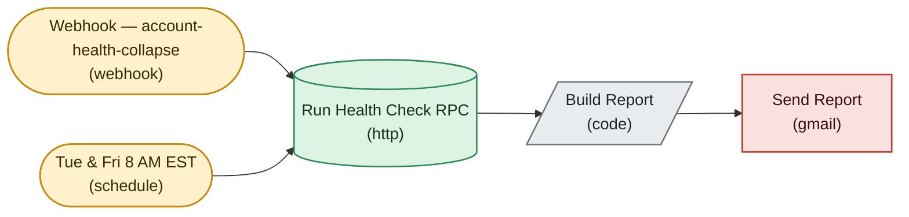

# Health View-Collapse Detector

*Auto-generated node graph of the live n8n workflow `[Health] View-Collapse Detector` (id `2Goujvw8qSvVzIfo`). State: active. Node count: 5. Pulled 2026-07-24.*

<!-- AUTO-GENERATED by arch-diagrams/generate.py -- do not hand-edit. Re-run to refresh. -->

> [!note] Live n8n name is `[Health] View-Collapse Detector`. This note is filed under a stable name so re-runs do not orphan the file.

The ban recorder. Compares recent view medians against the baseline, infers bans from view collapse, and writes health onto accounts plus events.

Shapes: stadium is a trigger, rhombus is an if branch, hexagon is a switch or merge, parallelogram is a code node, cylinder is a datastore, double-box is a loop. Colors group nodes by role.

Back to [[_Workflows — Index]] and [[Account Ops Data Model]].
