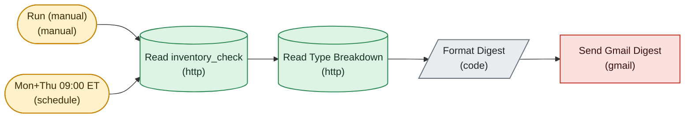

# Unified Inventory Monitor

*Auto-generated node graph of the live n8n workflow `[Unified] Inventory Monitor` (id `Q5VXmY5RFMXX2uBZ`). State: active. Node count: 6. Pulled 2026-07-24.*

<!-- AUTO-GENERATED by arch-diagrams/generate.py -- do not hand-edit. Re-run to refresh. -->

> [!note] Live n8n name is `[Unified] Inventory Monitor`. This note is filed under a stable name so re-runs do not orphan the file.

Daily runway digest. Checks how much approved content is queued per type and reports shortfalls.

Shapes: stadium is a trigger, rhombus is an if branch, hexagon is a switch or merge, parallelogram is a code node, cylinder is a datastore, double-box is a loop. Colors group nodes by role.

Back to [[_Workflows — Index]] and [[Account Ops Data Model]].
