# Unified Posting Agent

*Auto-generated node graph of the live n8n workflow `[Unified] Posting Agent` (id `lioNzkWRocyDvZS5`). State: active. Node count: 29. Pulled 2026-07-24.*

<!-- AUTO-GENERATED by arch-diagrams/generate.py -- do not hand-edit. Re-run to refresh. -->

> [!note] Live n8n name is `[Unified] Posting Agent`. This note is filed under a stable name so re-runs do not orphan the file.

The main posting engine. Runs daily, picks eligible accounts and content, drives the Geelark cloud phones to post to Instagram and TikTok, and records each task.

Shapes: stadium is a trigger, rhombus is an if branch, hexagon is a switch or merge, parallelogram is a code node, cylinder is a datastore, double-box is a loop. Colors group nodes by role.

```mermaid
flowchart LR
    classDef trigger fill:#FFF1CC,stroke:#C8860A,color:#3A2A05,stroke-width:1.5px;
    classDef store   fill:#DDF3E4,stroke:#2E8B57,color:#14331F,stroke-width:1.5px;
    classDef branch  fill:#F3E1F7,stroke:#8A3FA0,color:#331338,stroke-width:1.5px;
    classDef loop    fill:#DCE7FB,stroke:#2E5AAC,color:#10233F,stroke-width:1.5px;
    classDef ext     fill:#FBE0E0,stroke:#C0392B,color:#3A1010,stroke-width:1.5px;
    classDef proc    fill:#E9ECEF,stroke:#6C757D,color:#212529,stroke-width:1.5px;

    n0(["Daily 10:00 ET<br/>(schedule)"])
    n1(["Run (manual)<br/>(manual)"])
    n2[("Read accounts<br/>(http)")]
    n3[("Read music_library<br/>(http)")]
    n4["List Geelark Phones<br/>(http)"]
    n5[("Read unified_posts_due<br/>(http)")]
    n6[/"Stage Rows<br/>(code)"/]
    n7[["Loop Over Rows<br/>(loop)"]]
    n8["All Done<br/>(set)"]
    n9{"Switch by Media Shape<br/>(if)"}
    n10[/"Split Slides to Items<br/>(code)"/]
    n11["Get Slide Upload URL<br/>(http)"]
    n12[/"Merge Slides with Upload URLs<br/>(code)"/]
    n13["Get Geelark Upload URL<br/>(http)"]
    n14["Download Slide Image<br/>(http)"]
    n15["Download Video<br/>(http)"]
    n16[/"Pair Downloads with Upload URLs<br/>(code)"/]
    n17["Upload Video to Geelark<br/>(http)"]
    n18["Upload Slide to Geelark<br/>(http)"]
    n19[/"Pack Video Resource<br/>(code)"/]
    n20[/"Collect Resource URLs<br/>(code)"/]
    n21[/"Build Post Body<br/>(code)"/]
    n22{"Route by Platform<br/>(if)"}
    n23["Post IG via API<br/>(http)"]
    n24["Post TT via API<br/>(http)"]
    n25[("Mark IG Row Posted<br/>(http)")]
    n26[("Mark TT Row Posted<br/>(http)")]
    n27["Save IG Receipt<br/>(http)"]
    n28["Save TT Receipt<br/>(http)"]

    n0 --> n2
    n2 --> n3
    n3 --> n4
    n4 --> n5
    n5 --> n6
    n6 --> n7
    n21 --> n22
    n22 -->|"true"| n23
    n22 -->|"false"| n24
    n23 --> n25
    n27 --> n7
    n7 -->|"done"| n8
    n7 -->|"loop"| n9
    n24 --> n26
    n28 --> n7
    n1 --> n2
    n9 -->|"true"| n13
    n9 -->|"false"| n10
    n13 --> n15
    n15 --> n17
    n17 --> n19
    n19 --> n21
    n10 --> n11
    n11 --> n12
    n12 --> n14
    n14 --> n16
    n16 --> n18
    n18 --> n20
    n20 --> n21
    n25 --> n27
    n26 --> n28

    class n0,n1 trigger;
    class n2,n3,n5,n25,n26 store;
    class n4,n11,n13,n14,n15,n17,n18,n23,n24,n27,n28 ext;
    class n6,n8,n10,n12,n16,n19,n20,n21 proc;
    class n7 loop;
    class n9,n22 branch;
```

Back to [[_Workflows — Index]] and [[Account Ops Data Model]].
