# Unified Scheduling Agent

*Auto-generated node graph of the live n8n workflow `[Unified] Scheduling Agent` (id `rMWqyc60gPL7gVG0`). State: active. Node count: 12. Pulled 2026-07-24.*

<!-- AUTO-GENERATED by arch-diagrams/generate.py -- do not hand-edit. Re-run to refresh. -->

> [!note] Live n8n name is `[Unified] Scheduling Agent`. This note is filed under a stable name so re-runs do not orphan the file.

Decides what content posts when. Stamps a scheduled time onto approved content rows.

Shapes: stadium is a trigger, rhombus is an if branch, hexagon is a switch or merge, parallelogram is a code node, cylinder is a datastore, double-box is a loop. Colors group nodes by role.

```mermaid
flowchart LR
    classDef trigger fill:#FFF1CC,stroke:#C8860A,color:#3A2A05,stroke-width:1.5px;
    classDef store   fill:#DDF3E4,stroke:#2E8B57,color:#14331F,stroke-width:1.5px;
    classDef branch  fill:#F3E1F7,stroke:#8A3FA0,color:#331338,stroke-width:1.5px;
    classDef loop    fill:#DCE7FB,stroke:#2E5AAC,color:#10233F,stroke-width:1.5px;
    classDef ext     fill:#FBE0E0,stroke:#C0392B,color:#3A1010,stroke-width:1.5px;
    classDef proc    fill:#E9ECEF,stroke:#6C757D,color:#212529,stroke-width:1.5px;

    n0(["Scheduling Request<br/>(form)"])
    n1[("Read Registry<br/>(http)")]
    n2[("Read Buckets<br/>(http)")]
    n3[("Read Accounts<br/>(http)")]
    n4[("Read Existing Schedule<br/>(http)")]
    n5[("Read Pool<br/>(http)")]
    n6[/"Compute Plan<br/>(code)"/]
    n7[["Loop Assignments<br/>(loop)"]]
    n8[/"Format Summary<br/>(code)"/]
    n9["PATCH source table<br/>(http)"]
    n10["Send Summary<br/>(gmail)"]
    n11["Create Notion Card<br/>(http)"]

    n0 --> n1
    n1 --> n2
    n2 --> n3
    n3 --> n4
    n4 --> n5
    n5 --> n6
    n6 --> n7
    n8 --> n10
    n9 --> n11
    n11 --> n7
    n7 -->|"done"| n8
    n7 -->|"loop"| n9

    class n0 trigger;
    class n1,n2,n3,n4,n5 store;
    class n6,n8 proc;
    class n7 loop;
    class n9,n10,n11 ext;
```

Back to [[_Workflows — Index]] and [[Account Ops Data Model]].
